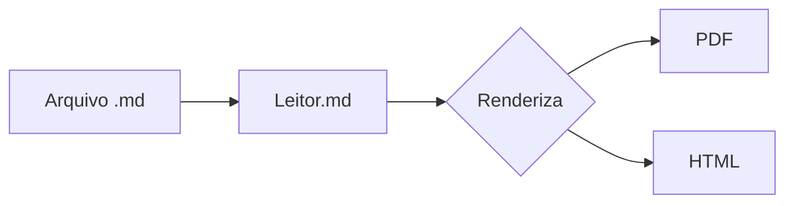

# Leitor.md — documento de exemplo

Este é um arquivo de **teste** para exercitar a leitura local (spec 8.1). O
_pipeline de renderização completo_ (GFM, código, LaTeX, Mermaid) entra no épico
8.5; por ora o app mostra o texto do arquivo.

## Lista de tarefas

- [x] Modelo de dados (seção 7)
- [x] Abrir arquivo local / iCloud (épico 8.1)
- [ ] Renderização completa (épico 8.5)

## Bloco de código

```swift
func saudacao(nome: String) -> String {
    "Olá, \(nome)!"
}
```

## Tabela

| Origem        | Precisa de rede |
|---------------|-----------------|
| Arquivo local | Não             |
| GitHub        | Sim             |

## Fórmula (KaTeX)

A identidade de Euler, inline $e^{i\pi} + 1 = 0$, e em bloco:

$$ \int_0^1 x^2 \, dx = \frac{1}{3} $$

## Diagrama (Mermaid)



> Fiel ao arquivo original: o app nunca grava no arquivo fonte (princípio 0.3).
